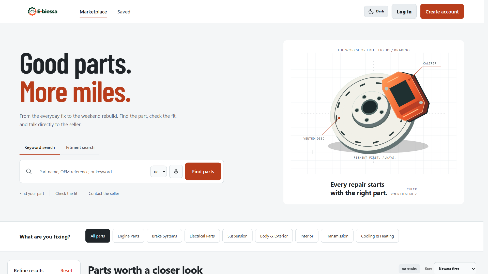
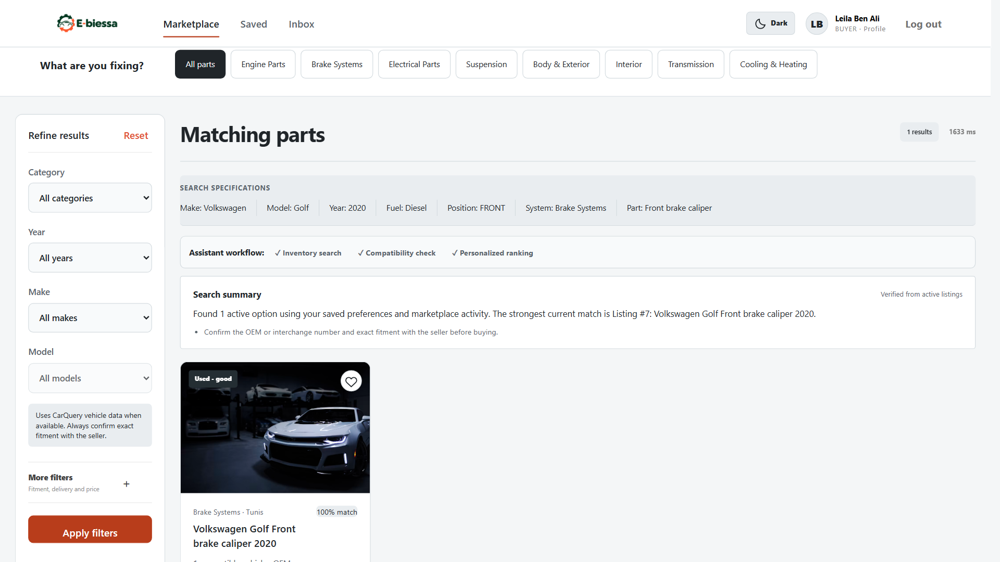
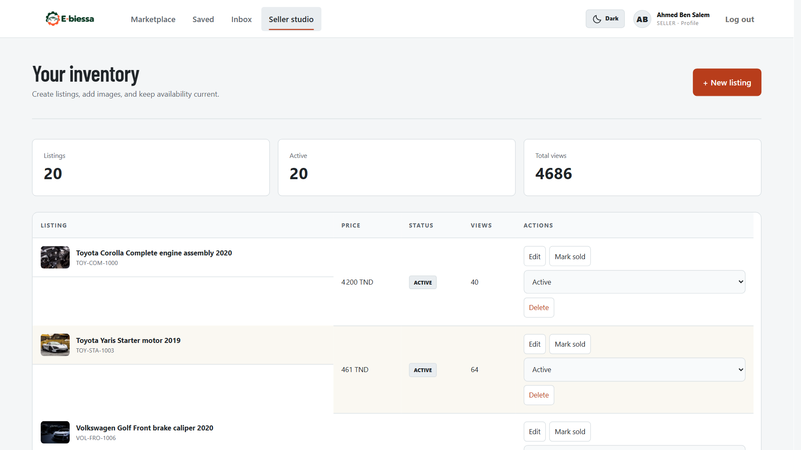
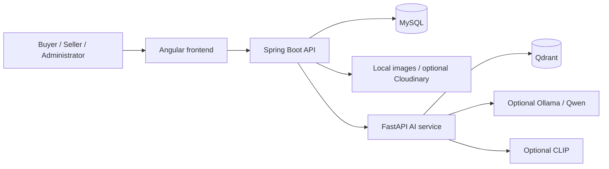

<p align="center">
  <picture>
    <source media="(prefers-color-scheme: dark)" srcset="marketplace-frontend/public/e-biessa-logo-dark.png">
    
  </picture>
</p>

<h1 align="center">The right part. Without the guesswork.</h1>

<p align="center">
  An automotive parts marketplace connecting buyers and sellers,<br>
  with compatibility-aware search, real-time messaging, and seller management.
</p>

<p align="center"><strong>Angular · Spring Boot · FastAPI · MySQL · Qwen · Docker</strong></p>

<p align="center">
  <a href="#features">Features</a> ·
  <a href="#screenshots">Screenshots</a> ·
  <a href="#architecture">Architecture</a> ·
  <a href="#getting-started">Getting started</a> ·
  <a href="#documentation">Documentation</a>
</p>



> An academic software-engineering project built around the Tunisian used-parts market.
> Intended for local development and demonstration, not a production deployment.

## Features

### For buyers

- **Find compatible parts:** keyword and natural-language search, vehicle filters, OEM references, sorting, and pagination.
- **Discover relevant listings:** explainable recommendations based on vehicle preferences, saved listings, and optional activity history.
- **Talk to sellers:** real-time conversations with image attachments, plus protected phone, WhatsApp, and email contact options.
- **Buy with more context:** public seller profiles, star ratings, reviews, and reporting tools.
- **Search your way:** optional photo-based part identification, browser voice input, and VIN-assisted vehicle selection.

### For sellers

- **Manage inventory:** create, preview, edit, and remove listings; mark sold parts to hide them immediately.
- **Show the details:** multiple compatible vehicles, engine and fuel information, part position, OEM references, warranty, and delivery options.
- **Present better photos:** previews, compression, drag-and-drop ordering, and primary-image selection.
- **Get price guidance:** advisory estimates based on comparable active listings, never automatic price changes.

### For administrators

- Review seller applications before granting seller access.
- Moderate reported listings and sellers, suspend accounts, and review audit logs.
- Manage the marketplace through a dedicated dashboard.

Across all roles: editable profiles, light/dark themes, JWT authentication, and optional social sign-in and account recovery integrations.

## Screenshots

Selected demonstration captures. Listings, photos, and account names shown are sample data;
these images are not evidence of actual part fitment or seller response times.

| Compatibility-aware search | Seller workspace |
| --- | --- |
| [](documentation/images/ai-search.png) | [](documentation/images/seller-studio.png) |

## Architecture



| Layer | Technologies | Responsibility |
| --- | --- | --- |
| Frontend | Angular 21, TypeScript | Marketplace, profiles, messaging, seller and admin workspaces |
| Core API | Spring Boot 3, Java 21, Spring Security, JPA | Authorization, business rules, persistence, WebSocket messaging |
| Database | MySQL | Accounts, listings, conversations, reviews, and moderation |
| Search service | FastAPI, FastEmbed, Qdrant, LangChain | Semantic retrieval and read-only tool orchestration |
| Models | Qwen 2.5 via Ollama, optional CLIP | Query extraction and image-based part-type suggestions |
| Quality & operations | Docker, Jenkins, SonarQube, Prometheus, Grafana | Build pipeline, analysis, metrics, and alerting |

### Search with explicit boundaries

Natural-language queries can be interpreted in English, French, and Tunisian transliteration.
The local Qwen model was adapted with Unsloth and QLoRA; training and evaluation scripts are included.

Model output does **not** establish compatibility. Deterministic checks validate constraints,
and Spring rechecks returned listings against MySQL before constructing the displayed answer.
Inactive listings and suspended sellers are excluded. Photo identification suggests a part type,
not vehicle fitment. Recommendations use an explainable content-based baseline, not a separately trained model.

## Getting started

### Prerequisites

- Java 21 and MySQL
- An Angular 21-compatible Node.js release; the frontend declares npm 10.9.4
- Python 3.12 for the AI service
- Optional: Ollama for model-backed query extraction; Docker Desktop for the DevOps stack

Commands below use **PowerShell**, starting from the repository root.
Keep each service in its own terminal. If you already have `.env` files, edit them instead of overwriting them.

### 1. Configure the services

Create the database in your MySQL client:

```sql
CREATE DATABASE marketplace;
```

For a fresh checkout:

```powershell
Copy-Item marketplace-api/.env.example marketplace-api/.env
Copy-Item ai-service/.env.example ai-service/.env
```

Edit the files before starting:

| File | Required configuration |
| --- | --- |
| `marketplace-api/.env` | Your `DB_URL`, `DB_USERNAME`, `DB_PASSWORD`; a random `JWT_SECRET` of at least 32 bytes; `CORS_ALLOWED_ORIGINS=http://localhost:4200` |
| Both `.env` files | The same long, random `AI_SERVICE_TOKEN` |
| `marketplace-api/.env` | Set `AI_SERVICE_ENABLED=true` for AI search; optionally set `SPRING_PROFILES_ACTIVE=local` for demonstration data |

Never commit real credentials. The example files are templates; `.env` files are ignored.

### 2. Start FastAPI — port 8001

```powershell
cd ai-service
py -3.12 -m venv .venv
.\.venv\Scripts\python.exe -m pip install -r requirements.txt
.\.venv\Scripts\python.exe -m uvicorn app.main:app --reload --host 127.0.0.1 --port 8001
```

Calling the environment's Python directly avoids PowerShell activation-policy issues.
Check [AI health](http://127.0.0.1:8001/health) or open the [API documentation](http://127.0.0.1:8001/docs).
The embedding model downloads on first use. Model weights and vector data are not included in Git.

### 3. Start Spring Boot — port 8080

In a new terminal at the repository root:

```powershell
cd marketplace-api
.\mvnw.cmd spring-boot:run
```

MySQL must already be running. Spring reads `.env` from the service working directory.

### 4. Start Angular — port 4200

In another terminal at the repository root:

```powershell
cd marketplace-frontend
npm ci
npm start
```

Open **[E-biessa](http://localhost:4200)**.
On subsequent launches, start MySQL and rerun only the three service start commands.

### 5. Initialize search and optional features

- **Search index:** sign in as an administrator and call `POST /api/admin/ai/reindex` with the administrator's bearer token. Listing changes subsequently trigger synchronization after database commits.
- **Local query model:** follow the [training and Ollama guide](ai-service/training/README.md), then set `OLLAMA_ENABLED=true` in the AI environment. The custom model is not bundled with a clone; without it, deterministic query parsing remains available.
- **Photo identification:** install the optional vision requirements and follow the [image and voice guide](documentation/IMAGE_AND_VOICE_SEARCH.md).
- **Social login / recovery:** configure provider credentials before enabling the integrations. See [configuration details](#configuration-details).

<details>
<summary><strong>Local demonstration accounts</strong></summary>

The `local` or `dev` profile seeds demonstration data, including 60 listings, three sellers,
three buyers, and an administrator. Seeding preserves existing records rather than resetting the database.

| Role | Email | Development password |
| --- | --- | --- |
| Buyer | `buyer01@e-biessa.tn` through `buyer03@e-biessa.tn` | `Buyer123!` |
| Seller | `seller01@e-biessa.tn` through `seller03@e-biessa.tn` | `Seller123!` |
| Administrator | `admin@e-biessa.tn` | `Admin123!` |

These are public development credentials. Never expose a seeded instance publicly.
Existing accounts whose passwords have changed are not reset by these instructions.

</details>

## Testing and DevOps

Run from the indicated service directory:

| Service | Command |
| --- | --- |
| Spring Boot | `.\mvnw.cmd verify` |
| FastAPI | `.\.venv\Scripts\python.exe -m pytest` |
| Angular unit tests and build | `npm run verify` |
| Browser tests | `npx playwright install chromium`, then `npm run test:e2e` |

Live-stack browser tests require running services and configured test accounts;
ordinary browser tests use controlled API responses. A passing mocked test is not a live-stack validation.

The [DevOps guide](documentation/DEVOPS.md) covers Docker, Jenkins, SonarQube,
Prometheus, Grafana, Alertmanager, and Blackbox Exporter. The pipeline is configured to run tests,
apply a quality gate, and build images. Registry publication is opt-in; no current build status is asserted here.

## Configuration details

<details>
<summary><strong>OAuth, recovery, storage, and privacy</strong></summary>

- **OAuth:** configure Google, Facebook, or Microsoft credentials in `marketplace-api/.env` and enable `OAUTH_ENABLED`. Register `http://localhost:8080/login/oauth2/code/{provider}`, replacing `{provider}` with `google`, `facebook`, or `microsoft`. Redirects exchange a short-lived single-use code, not a JWT in the URL.
- **Recovery:** configure `SMTP_*` and `RECOVERY_EMAIL_ENABLED` for email, or `TWILIO_*` and `RECOVERY_SMS_ENABLED` for SMS. Development recovery behavior is for local testing only.
- **Images:** local storage is the development default. Cloudinary is optional through `CLOUDINARY_*` settings.
- **Recommendations:** buyers can disable activity personalization or clear history without deleting saved listings or conversations. Raw messages and contact details are not sent to recommendation tools.
- **VIN:** decoding uses NHTSA vPIC to select existing catalog vehicles; VINs are not stored and decoded data does not guarantee fitment.
- **Voice:** recognition depends on browser support and its speech service. Typed search remains available.

See the [Spring environment template](marketplace-api/.env.example) and [AI environment template](ai-service/.env.example) for configuration keys.

</details>

## Documentation

| Guide | What it covers |
| --- | --- |
| [Architecture](documentation/ARCHITECTURE.md) | Service responsibilities and data boundaries |
| [AI service setup](ai-service/README.md) | Search, models, indexing, and configuration |
| [Training and evaluation](ai-service/training/README.md) | Dataset generation, QLoRA, evaluation, and export |
| [Search orchestration](documentation/AGENT_ORCHESTRATION.md) | Read-only tools and deterministic answers |
| [Recommendations](documentation/RECOMMENDATIONS.md) | Ranking, eligibility, and privacy |
| [VIN compatibility](documentation/VIN_COMPATIBILITY.md) | Vehicle decoding and limitations |
| [Image and voice search](documentation/IMAGE_AND_VOICE_SEARCH.md) | Optional inputs and setup |
| [DevOps](documentation/DEVOPS.md) | CI, containers, monitoring, and troubleshooting |
| [GHCR local demo](documentation/GHCR_DEMO.md) | Isolated image deployment, two API replicas, monitoring, and verification gates |

## Project scope

E-biessa connects buyers and sellers; it does not process payments or orders.
Compatibility must be confirmed with the seller using the exact vehicle and OEM reference.
External providers need their own credentials or availability. Production deployment and fully validated
multi-instance high availability are outside the current demonstrated baseline.

Academic reports, presentation drafts, caches, secrets, and model binaries stay outside Git.
Only a small selection of documentation screenshots is included here.
